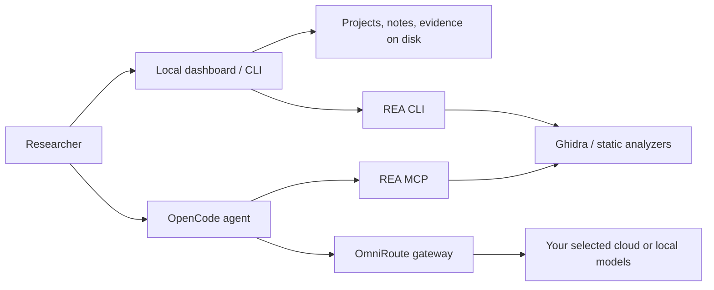

# REA Workbench

**A local workspace for reverse engineering with REA, OmniRoute, and OpenCode.**

Create investigations, inspect artifacts, retain evidence, and work with an AI model of your choice. Projects live on your computer, outside the source checkout. The software is MIT licensed. No Claude Code subscription is required.

This is an independent integration project, not a fork or an official release of REA, OmniRoute, or OpenCode.

## What works in v0.1

- Local dashboard: investigation goals and authorization scope, notes, archives, and analysis history.
- Static analysis: JavaScript/Electron, native binaries through Ghidra, .NET assemblies, and SQLite snapshots through REA.
- Evidence files, diagnostics, timestamps, exit status, and SHA-256 hashes per run.
- OpenCode sessions connected to REA MCP and your own OmniRoute gateway key.
- Configurable gateway, model, Java, and Ghidra paths; model discovery and readiness checks.
- Summary export for scope, notes, and run metadata. Raw target bytes and raw evidence are excluded from that export. Evidence downloads are separate.
- Security tests, pinned dependencies, CI, dependency updates, CodeQL configuration, a threat model, and a documented secure development process.



## Start

Install a supported Node.js release: 22.x >=22.19, 24.x >=24.11, or 26+. Git is needed to clone this repository. Then:

```sh
git clone https://github.com/ycgiio/rea-workbench.git
cd rea-workbench
npm ci
npm run prepare:agent
node bin/reaw.js init
npm start
```

Open **http://127.0.0.1:4317**. The dashboard and static workflows work without an AI key. `npm ci` disables dependency lifecycle scripts through this repository's `.npmrc`; `prepare:agent` explicitly prepares only the pinned OpenCode binary. Frida's optional installation script is not run; runtime instrumentation is outside this release's dashboard workflows.

### Connect OmniRoute and select a model

Use your own [OmniRoute installation](https://github.com/diegosouzapw/OmniRoute) and gateway key. Create that key in your gateway and connect providers there. This repository does not distribute keys, accounts, subscriptions, or model access.

PowerShell:

```powershell
$env:OMNIROUTE_API_KEY = "YOUR_OWN_GATEWAY_KEY"
$env:OMNIROUTE_MODEL = "EXACT_MODEL_ID_FROM_YOUR_GATEWAY"
node bin/reaw.js models
npm start
```

Linux/macOS:

```sh
export OMNIROUTE_API_KEY='YOUR_OWN_GATEWAY_KEY'
export OMNIROUTE_MODEL='EXACT_MODEL_ID_FROM_YOUR_GATEWAY'
node bin/reaw.js models
npm start
```

Keep keys out of shell history when practical: use a secret manager or protected environment file. To load a specific environment file, set `REAW_ENV_FILE` to its absolute path. Workbench never automatically loads `.env` files from investigated targets. See [.env.example](.env.example). Do not use a Claude CLI access token where an OmniRoute gateway key is required.

The default endpoint is `http://127.0.0.1:20128/v1`. Set `OMNIROUTE_BASE_URL` for another OpenAI-compatible service, including a local inference server. Remote endpoints require HTTPS. Gateway and model settings can also be saved through **Gateway & diagnostics**; environment variables take precedence. Cloud inference sends selected context to that provider.

Free-tier access depends on each provider's terms, quotas, model availability, and account eligibility. OmniRoute does not make a paid model free. No fallback to a paid model is configured by Workbench. Review gateway routing rules and costs yourself. For usage independent of cloud quotas, connect a local model server and review the chosen model's license and hardware requirements.

### Native analysis

Install Ghidra separately from its [official releases](https://github.com/NationalSecurityAgency/ghidra/releases), and a full JDK compatible with its release. REA 6.5.0's Windows guide uses Ghidra 12.1.x and JDK 21+. Set `GHIDRA_INSTALL_DIR` and `JAVA_HOME` or save their paths in the dashboard. Workbench does not download native engines or change system Java settings.

Windows native support in REA is experimental, with a limited read-only PE/raw-image boundary. Other target formats and operating systems have their own requirements. Consult [REA's Windows guide](https://github.com/morluto/rea/blob/main/docs/windows-ghidra-p0.md) and the documentation matching your installed release.

### Your first investigation

1. Create an investigation and record the goal and authorized scope.
2. Put files in the project's `targets` folder, or enter an absolute path you are authorized to inspect.
3. Select an analysis type and run it. Workbench saves evidence under `runs`.
4. Record findings in notes, with evidence references and remaining uncertainties.
5. Open a terminal in the repository and run the project's displayed `agent` command for AI assistance.

```sh
node bin/reaw.js list
node bin/reaw.js agent PROJECT_ID
```

OpenCode asks before tool actions. Its configuration contains an environment reference for your key. Generated project instructions remind the agent to treat artifacts as untrusted evidence. These prompts and approval settings are not an OS sandbox. Additional local/global OpenCode configuration may affect the session; inspect it before approving actions.

The default **Focused** catalog enables seven REA tools for session discovery and common static/native analysis, reducing schema context sent to the model. Other REA operations remain available through its CLI with approval. Select **Full REA catalog** in settings to expose all tools directly; this can require substantial model context and quota. Model selection never changes silently to cover a context limit.

## Storage and customization

By default, data is stored in `~/.rea-workbench`:

```text
config.json                 # Paths and model selection, no API keys
projects/<uuid>/
  project.json              # Goal, scope, status
  notes.json
  targets/                  # Files you place here
  reports/                  # Your findings
  runs/<uuid>/
    run.json                # Command, state, timestamps, evidence hash
    evidence.json
    stderr.log
```

Set `REAW_HOME` to another private local directory. Back up that directory with your preferred encrypted backup tool. An evidence hash detects a changed file when compared with a trusted hash; it is not a signature or a tamper-proof audit trail. Never commit project data or keys to this public repository.

Developers and AI assistants can extend `src/`, `web/`, and `test/`; read [AGENTS.md](AGENTS.md) and [CONTRIBUTING.md](CONTRIBUTING.md). Add integrations through reviewed code changes and tests. This version does not load arbitrary plugins or execute user-defined shell commands from configuration.

## Commands

| Command after `node bin/reaw.js` | Purpose |
| --- | --- |
| `init` | Create the local config and storage root |
| `serve [PORT]` | Start the localhost dashboard |
| `create "Name" "Goal" "Authorized scope"` | Create an investigation |
| `list` | List investigations |
| `analyze ID javascript\|native\|managed\|sqlite TARGET` | Run a static workflow |
| `agent ID` | Open OpenCode with project-specific REA configuration |
| `agent-config ID` | Generate the OpenCode config without starting it |
| `models` | List gateway model IDs |
| `doctor` | Check agent, gateway, and Ghidra readiness |
| `export ID OUTPUT.json` | Write a new summary file; refuses overwrite |

## Development and security

```sh
npm ci
npm run prepare:agent
npm run check
npm test
npm audit --audit-level=high
npm run sbom
```

See [security policy](SECURITY.md), [threat model](docs/THREAT-MODEL.md), [standards mapping](docs/STANDARDS.md), [architecture](docs/ARCHITECTURE.md), and [roadmap](docs/ROADMAP.md).

Workbench is an early single-user local application. It is not a multi-user cloud service, malware sandbox, or certified forensic system. Do not expose its port using a tunnel or reverse proxy. Inspect untrusted binaries in an isolated environment. There is no blanket claim of regulatory compliance or unrestricted access to third-party tools. Authorization, privacy, applicable law, and upstream licenses still apply.

## Credits and license

- [REA](https://github.com/morluto/rea) by morluto and contributors — reverse engineering tools (MIT).
- [OmniRoute](https://github.com/diegosouzapw/OmniRoute) — configurable AI gateway (MIT).
- [OpenCode](https://github.com/anomalyco/opencode) — open-source coding agent (MIT).
- [Ghidra](https://github.com/NationalSecurityAgency/ghidra) — optional native analysis engine (Apache-2.0 and third-party notices).

Workbench's original code is [MIT licensed](LICENSE). Dependencies, model weights, targets, and generated evidence retain their own licenses and rights. See [THIRD_PARTY_NOTICES.md](THIRD_PARTY_NOTICES.md).
